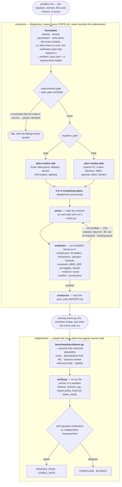

# Autonumerics

Describe a differential equation in plain English. Get back a numerical solver, the schemes it beat, and an honest account of what its score rests on.

Autonumerics is a Claude Code plugin. Seven agents and an orchestrator read a problem statement, design several competing schemes, implement and test each one in parallel, and return the winner. Two things make the answer checkable rather than merely plausible: the score is computed by a deterministic Python kernel instead of written by a language model, and a benchmark the agents are forbidden to read re-runs the winner against ground truth authored separately.

- **66 problems** in three suites — 33 PDE, 33 SDE, tiered from textbook to past what the reference manuals describe, including ten whose answer keys a third party published before this project existed
- **1042 tests** over the verification library and the benchmark harness, including canaries that are wrong on purpose
- **Zero overclaims** on the closed-form suite across every recorded sweep; **one** on the suite built to provoke them, which is the most useful result in this repo

## The problem it addresses

Numerical solvers are easy to write and hard to trust. A scheme can run without errors, produce a smooth plot, and still be wrong, because it quietly violated a stability condition or stopped enforcing a boundary condition after the first step. The failure is silent. You only catch it by comparing against something you already know.

So the pipeline never accepts a solver on the strength of it running. Every candidate is measured, and a plan is only finished when every gate its evidence path requires comes back clean.

That leaves two circularity problems, and most of this repo is the answer to them.

**First: the pipeline grades itself.** The agent that writes down the exact solution is part of the same pipeline that scores against it, and an agent that transcribes the wrong exact solution will still award itself a perfect score. So the benchmark keeps its own ground truth, in code the agents never read, enforced by deny rules rather than by good intentions, and every answer the pipeline produces is re-run against it.

**Second: some problems have no exact solution to transcribe.** Chaos, coarsening, an eigenproblem, a Cole–Hopf quadrature. There the pipeline cannot be handed a formula at all, and a score has to be assembled out of weaker evidence — manufactured solutions, operator residuals, invariants, convergence under refinement, agreement between independently written schemes. Those are not equivalent to a closed form, and the pipeline does not pretend they are: every score carries a `provenance` tag naming the tier of evidence it rests on, all the way into the report.

## How it works



The loop that matters is solver ↔ evaluator. The solver writes real code and runs it. The evaluator runs the kernel over it, transcribes the result, and sends back a specific diagnosis rather than a verdict — "CFL violated, dt over dx squared is 1.0 against a limit of 0.5, halve dt", or "Dirichlet condition is not enforced after each step". The solver acts on it and the cycle repeats until the plan certifies, plateaus, or runs out of iterations.

Each agent owns its own files and cannot write another's. `STATE.md` is a durable ledger, so an interrupted run resumes mid-cycle instead of starting over. The conductor reads three fields of the spec to route the problem and dispatches everything else; it never evaluates mathematics. The full file-permission table is in [docs/architecture.md](docs/architecture.md).

### The score is computed, not assigned

Everything numeric lives in [verifylib/](verifylib/), a plain Python package with no model in the loop:

| Half | What it does |
|---|---|
| **guardrails** | spec validation (an expression where a program would hide an answer), the analytic-reference check (does the claimed closed form satisfy the spec's own equation?), answer-key leakage scans, ledger re-audit, numeric-claim binding |
| **kernel** | nested refinement ladders, Richardson/GCI with asymptotic-range guards, the operator residual, the invariant registry, manufactured-solution and degenerate-limit drivers, SDE surrogates (moment ODE, Kolmogorov solve, stationary density), common random numbers, Dynkin's identity — **and the scoring rubrics themselves** |

The rubrics are decision tables with no judgement in them, so handing their booleans to a language model adds no information and adds a drift surface. The evaluator's one authority is asymmetric: it can record `agent_cap` to lower a score, never to raise one. `verifylib` rejects a review whose headline score disagrees with the metrics block.

Three fields come out, and they answer different questions:

- **`certified`** — did every gate this problem's evidence path require come back clean? This is the terminal condition the loop exits on and what the benchmark reads for `VERIFIED_PASS`.
- **`score`** (1–10) — that, *and* how far inside the tolerance the run landed. The evidence tier opens a band; a quality index places the plan within it.
- **`provenance`** — which tier of evidence the score rests on.

### The ladder of evidence

Ground truth is not binary, so the pipeline does not treat it that way. Each tier is objective; each certifies something weaker than the one above.

| Tier | Evidence | What it certifies | Tag |
|---|---|---|---|
| **A** | Closed-form solution / exact moments | The answer is right | `analytic` |
| **A′** | Deterministic surrogate — moment ODE, Kolmogorov solve, stationary density | The answer is right, to a controlled tolerance | `surrogate` |
| **B** | Manufactured solution or degenerate limit, plus a clean operator residual | The **scheme and code** are right | `manufactured` |
| **C** | Self-convergence + Richardson extrapolation | It converges, and by how much it is off | `self_convergence` |
| **D** | Invariants, residuals, symmetries, constraints | It is not wrong in specific detectable ways | *(supporting)* |
| **E** | Cross-plan agreement between method families | Independently written methods concur | *(supporting)* |

Tiers C, D and E are self-referential — they all descend from the same `problem_spec.json`. If the formulator misread a boundary condition, every plan converges, every plan agrees, every invariant holds, and every plan solves the wrong problem. Only A, A′ and B break that circularity, which is why a 10 without a closed form requires **two independent breaks** (`manufactured_partial` caps at 9, `self_convergence` at 8) and why, on a no-closed-form problem, the conductor will not declare a winner until a second scheme *family* has been evaluated, and any two plans that both score ≥ 9 have been differenced at the graded grid — with a disagreement capping both at 8, since the difference does not say which one is wrong.

### Passing criteria

| Class | Terminal condition |
|---|---|
| **PDE** | relative L² error < 1% **and** observed convergence order ≥ the problem's floor **and** every declared invariant and structural gate holds |
| **SDE** | variance relative error < 10% **and** mean relative error < 5% (unless the exact mean is near zero), **and** the estimates are Monte-Carlo-resolved, **and** Dynkin's identity holds for the generator built from the spec's own drift and diffusion |

That last SDE clause is newer than the rest of the pipeline, and [why](#where-the-self-grading-was-weakest) is one of the more interesting things measured here.

## Running it

You need the [Claude Code CLI](https://claude.com/claude-code), [uv](https://docs.astral.sh/uv/), and Anthropic credentials.

```bash
uv sync --extra dev
```

Write your problem in plain English at `workspace/my_problem/problem.md` — the equation, the domain, the initial and boundary conditions, the horizon, and what to report. You do not need to state a solver signature or a tolerance; the agents own that contract. Then:

```bash
claude --plugin-dir . -p "/conductor workspace/my_problem/problem.md"
```

Results land in that directory:

```
workspace/my_problem/
├── problem_spec.json   the formulator's extraction, plus a ledger of every constraint in problem.md
├── STATE.md            the run ledger (resume from here if interrupted)
├── plans/{id}-{slug}/  one per competing scheme: SOLUTION.md, solver.py, <metrics>, the review it got
├── agreements.json     recorded cross-plan differences, bound to solver hashes
└── REPORT.md           every scheme tried, the winner and why, and the verification gaps
```

Read `REPORT.md` first, and read its provenance line before its score. A 10 earned against a closed form and a 10 earned by self-convergence are different claims.

The plugin ships `PreToolUse`, `PostToolUse` and `Stop` hooks, so the guardrails apply to your own problem and not only to benchmark runs. A run whose spec drops a constraint from `problem.md` halts at `phase: blocked` with the failing entries quoted — that is a correct outcome, not a crash.

To grade one plan yourself, without the pipeline:

```bash
uv run python verifylib/cli.py evaluate workspace/my_problem/plans/1-my-plan
uv run python verifylib/cli.py evaluate <plan_dir> --json        # full detail
uv run python verifylib/cli.py compare <plan_a> <plan_b>         # difference two plans at the graded grid
uv run python verifylib/cli.py gate workspace/my_problem         # the whole-workspace guardrail sweep
uv run python verifylib/cli.py rank workspace/my_problem         # the ranking the conductor uses
```

Run the test suite with:

```bash
uv run --extra dev python -m pytest verifylib benchmark/tests -q    # 1023 passed, 1 failed, ~11 min
```

`--extra dev` is required; a plain `uv run` re-syncs to the base dependencies and uninstalls pytest.

The one failure is known and is a test-side bug, not a verifier one: `test_frozen_records_fall_back_to_the_old_test_unchanged` re-grades every frozen pipeline record it can find and asserts it saw more than 50, but it looks for them with a non-recursive `os.listdir`, and the results were moved into `benchmark/results/{pipeline,studies,...}/` subfolders in c21077e. It now sees 28 and fails on the count; every record it does read still re-grades correctly.

## The benchmark

Fifty-six problems with independently authored checks, split into two suites that run separately.

| Suite | Problems | What it is for |
|---|---|---|
| **main** | 49 — 27 PDE, 22 SDE | problems with a closed form or machine-precision moments. The SDE side is deliberately weighted toward hard tier-3 cases drawn from a numerical-SDE literature review |
| **no-closed-form** (`--no-closed-form`) | 7 — 6 PDE, 1 SDE | problems with *no formula to transcribe*, which is where a pipeline that scores itself against a closed form has nothing to lean on |

Tier 1 is textbook material the reference manuals cover. Tier 2 needs care: boundary layers, indefinite operators, 100:1 anisotropy, multi-field systems, 3D. Tier 3 goes past what the manuals describe — a shock, a Caputo fractional derivative, a Feller condition violation that drives variance to zero, thirteen noise channels that do not commute, chaos, and two blow-up problems where the only correct behaviour is to stay finite.

Every problem is independently checkable, by one of these routes:

| Route | What the answer key is | Count |
|---|---|---|
| **exact** | a closed form, or moments cross-checked against moment-ODE integration, matrix exponentials and direct simulation | 58 |
| **reference** | for superlinear SDEs, a *discretization-free* Monte-Carlo of the known exact solution (zero scheme bias), compared within a standard-error-aware tolerance; for PDEs, a harness-owned high-resolution field built offline by **two independent method families**, whose disagreement is measured, stored, and used to widen the tolerance — so the answer key's own error can never fail a correct solver | 6 |
| **stability** | nothing but "a correct scheme stays finite and in its domain", which is exactly what a naive scheme gets wrong | 2 |
| **functional** | a scalar quantity of interest — an eigenvalue, an option price — rather than a field or a moment | +11 overlay |
| **published** | the answer key was computed by somebody else, before this project existed. The ten problems of the externally anchored suite: seven graded against values published in 2018 and re-derived here before being trusted, and three *de-memorized* controls at a shifted initial condition whose keys this repo computes, so a model that recalled a published constant scores well on the first set and badly on the second | +10 overlay |

The first three routes partition the 66; the last two are overlays on them, which is why they are counted with a plus. `verify.py` refuses to score against a reference that does not carry a measured error: an answer key whose accuracy nobody established is not ground truth.

```bash
uv run python benchmark/setup.py                                  # stage every problem.md
uv run python benchmark/run.py --only pde_heat_1d                 # one problem, to see it work
uv run python benchmark/run.py                                    # the full main suite (hours, real API usage)
uv run python benchmark/run.py --suite no-closed-form \
    --results-json benchmark/results/pipeline/no_closed_form.json # a suite of its own
uv run python benchmark/run.py --skip-run                         # re-verify existing workspaces for free
uv run python benchmark/verify.py --slug sde_gbm                  # check one solved problem independently
uv run python benchmark/validate_ground_truth.py                  # check the answer keys themselves
```

Add `--resume` to continue an interrupted sweep, `--type`/`--tier` to stagger a run, and `--fresh` to clear prior outputs. Solvers under verification run in a separate process with a wall-clock timeout, a memory cap, and an enforced import policy, so a runaway solver or one reaching for a library it should not use fails cleanly instead of hanging the sweep.

**Isolation is enforced, not assumed.** `benchmark/pipeline-settings.json` denies every pipeline invocation read access to `benchmark/`, and each run additionally gets a generated settings file denying every *other* problem's workspace and every archived run, so a run sees exactly one workspace — its own. Deny rules hold even under `--dangerously-skip-permissions`. Full detail, including the three real leaks this caught, is in [benchmark/README.md](benchmark/README.md).

## Results

Result JSONs are regenerable artifacts and are gitignored; the committed [benchmark/results/REPORT.md](benchmark/results/REPORT.md) is the most recent run (the three-problem no-closed-form wave). Every table below names the run it came from so the claim is attributable.

### The main suite

| Sweep | Problems | Independently confirmed | Overclaims | Notes |
|---|---|---|---|---|
| 2026-07-16, Opus + Sonnet | 37 (15 PDE, 22 SDE) | **35 of 36** checkable | **0** | 33 `VERIFIED_PASS` + 2 `STABLE_PASS`; Kuramoto–Sivashinsky had no answer key yet (`SELF_ONLY`); one run errored (`sde_ginzburg_landau_s6`) |
| 2026-08-12, Sonnet-pinned | 35 (28 PDE, 7 SDE) | **33 of 34** checkable | **0** | one genuine `FAIL` on the inviscid Burgers shock |
| 2026-08-29, Opus + Sonnet | 28 (22 PDE, 6 SDE) | **27 of 27** checkable | **0** | 25 `VERIFIED_PASS` + 2 `UNDERCLAIM` — the pipeline gave up below certification on two problems whose solvers in fact pass |

An `UNDERCLAIM` is the failure mode worth having: the pipeline refused to certify a correct answer because its own evidence was not conclusive. The one it exists to avoid is the `OVERCLAIM`, and on the closed-form suite there has not been one.

The hardest additions are covered. All thirteen of the multi-field and 3D tier-3 PDE problems — 2D Navier–Stokes, 2D MHD, 3D Maxwell, 2D elasticity, Keller–Segel chemotaxis, Heston, the porous-medium equation, Monge–Ampère, a Stefan moving boundary, Cahn–Hilliard, the Fichera corner, an L-shaped domain with a reentrant singularity, and 3D layered acoustics — came back `VERIFIED_PASS` on the 2026-08-12 sweep, with seven of them re-confirmed on 2026-08-29.

### The overclaim it was built to catch

The main suite's clean record is partly a statement about the suite: when a closed form exists, the formulator transcribes it and the evaluator has something real to grade against. So a second suite was built from problems with *no formula at all*, and on the first run of it (2026-09-19) the pipeline produced the finding:

| Problem | Self-score | Independent check | Verdict |
|---|---|---|---|
| `pde_kuramoto_sivashinsky` | 10/10, `manufactured` | relL2 = **7.2e-02** | **OVERCLAIM** |
| `pde_burgers_viscous_1d` | 10/10, `analytic` | 3.6e-04 | PASS |
| `pde_cahn_hilliard_2d_coarsening` | 10/10, `manufactured` | 6.6e-05 | PASS |
| `pde_schrodinger_eigen_2d` | 10/10, `manufactured` | 8.4e-05, λ₁ to 2.9e-04 | PASS |

Chaos is where the pipeline was certifying accuracy at a horizon the problem did not ask about — and grading every plan, not just the winner, showed the bias was broader: on *both* reference-field problems the kernel ranked the least accurate plan first, by three orders of magnitude on Cahn–Hilliard (a spectral plan at 4.5e-08 scored 9; the FD4 plan at 6.6e-05 scored 10). Kuramoto–Sivashinsky is the one case where that crossed the pass line.

That produced six pipeline fixes and fourteen kernel-contract gaps recorded as failing tests, then flipped. The re-run on three held-out problems (2026-09-25) came back:

| Problem | Winning scheme | Independent check | Solver↔evaluator cycles, all plans |
|---|---|---|---|
| `pde_kdv_zabusky_kruskal` | spectral ETDRK4 | relL2 = 5.0e-09, p = 5.47 | 3 |
| `pde_gross_pitaevskii_1d` | Fourier spectral + Yoshida-4 | relL2 = 2.0e-06, p = 5.71 | 2 |
| `sde_double_well_langevin` | drift-implicit trapezoid | varErr 0.2%, meanErr 1.0% | 3 |

Ten plan directories were graded across those three problems, not three, and the conductor's winner was the most accurate plan every time (`wrong_plan_won: 0/2`) — a number that is invisible in a winner-only record, which is why the harness now grades every plan with a `solver.py` in it.

Two numbers from building those answer keys are worth stating, because they are the reason a chaotic problem can have one at all: two independent spectral time integrators on Kuramoto–Sivashinsky agree to **1.2e-09** at t = 50 — six orders below the 1% gate — and the Cole–Hopf quadrature behind viscous Burgers converges to **5.6e-16**.

### Where the self-grading was weakest

The most uncomfortable measurement in the repo is about the SDE side, and it was found by auditing what the rubric actually read rather than by a failing run. Until 2026-10-15 the SDE analytic rubric read only the two moment thresholds and the Monte-Carlo resolution. Twenty-one of the twenty-three SDE problems are on that path. So a solver that **drew samples from the exact terminal law and never integrated the SDE at all** scored 10, `certified`, provenance `analytic`.

Closing it meant requiring generator evidence — Dynkin's identity against the drift and diffusion in the spec — and the before/after sweep over twelve live plans is recorded in [docs/expectations-sde-verification-gaps.md](docs/expectations-sde-verification-gaps.md). Eight findings from it that were not obvious in advance:

- `sde_gbm_2d_high_corr` took **0 seconds** of verification before the fix and **397 seconds** after. It was free because neither ladder ran on it — which was the defect, not a feature.
- The thirteen-channel stiff problem's order study had been reporting `unavailable` because of an `IndexError` in multi-noise indexing. With noise dimension plumbed through, it measures order **0.783**.
- Correlation had been free: a 2-D correlated problem now has its cross moment graded against ρ = 0.9478.
- The order study was reporting noise as a measurement. With a standard error attached, two plans whose measured orders were 0.45 and 0.64 now **abstain** rather than claim a pass, and one plan whose "order" of 9.4e-15 was pure roundoff stopped reading as a success.
- Abstention and failure are priced differently on purpose, and the split is load-bearing: an order study that abstains costs nothing (the estimator failed, not the solver), while a Dynkin check that abstains **withholds certification** — nothing else can establish that the paths came from this equation. One plan moved 10 → 9 on exactly that rule, with its moments still passing.
- Two `ginzburg_landau_s6` plans gained a working Kolmogorov surrogate and still score 3, because a failed Dynkin (z = 3.24, 3.14) sits ahead of the surrogate row. Evidence for the scheme does not excuse evidence against the equation.
- A one-sided-domain Kolmogorov surrogate that had stopped working was recovered with a truncation shift measured at 0.0036082 — against 0.00361 predicted before implementing it.
- `STATE.md` and the metrics agreed on score and provenance 6/12 before the work and **12/12** after. Half of the ledger's claims had been transcription.

The suite grew 580 → 643 → **690 tests** across those two rounds, and a declared `numpy>=1.26.0` floor was found to be wrong — five PDE tests fail on 1.26.4 — and corrected to `>=2.0.0`, held by a metadata test.

### Guardrails, measured

| | Result |
|---|---|
| Claimed closed forms confirmed against the spec's own equation | **21 of 25** — PDE 16/20, SDE 5/5 |
| Corrupted closed form vs. correct, residual check | ≥ 2.5e-01 vs. ≤ 4.8e-09 — seven orders |
| False positives, expression check | **0** of 29 staged specs |
| False positives, AST leakage scan | **0** of 137 pipeline files |
| False positives, numeric-claim binding | **0** of 206 archived reviews |
| Seeded-defect canaries caught by the named tier | **7 of 7**, with the honest control triggering none |
| Whole-workspace gate | 2.3 s |

The leakage scanners exist because the leak is real and was observed before they were added: a `pde_heston_2d` spec cited `benchmark/problems.py, _heston_call` and told the evaluator to transcribe it verbatim; a `sde_quintic_drift_noise` evaluator cited `benchmark/verify.py` for its pass criterion; and a Cahn–Hilliard formulator `cat`-ed its manufactured-solution twin's `problem_spec.json` as a template, in two separate attempts. Each one turned an independent check into a self-check, silently. The first two artifacts are preserved byte-for-byte as test fixtures under `verifylib/tests/fixtures/`, which ruff is configured never to reformat, so the evidence survives; the Cahn–Hilliard snapshot lives only in the gitignored `benchmark/results/`.

### The schemes it picked

On the hard problems the choices were not generic, which is the clearest sign the plan-creators are doing numerical work rather than pattern-matching:

| Problem | What it chose |
|---|---|
| singularly perturbed boundary layer | Il'in fitted scheme |
| Caputo fractional time derivative | L1 scheme on a graded mesh |
| inviscid Burgers shock | Godunov |
| FENE spring confined to (−1, 1) | drift-implicit Euler–Maruyama, to keep the step inside the domain |
| KdV soliton fission | spectral ETDRK4 |
| Ginzburg–Landau at σ = 6, where untamed Euler NaNs | log-transform Euler |
| quintic drift with a Gaussian initial condition | exact-flow integration |
| 2D MHD | streamfunction–vorticity with constrained transport |
| Stefan moving boundary | Landau transform + explicit RK2 |

### Ranking, after it was rebuilt

The conductor does not rank by hand; it runs `verifylib/ranking.py`, the same function the baseline study uses. Score and provenance stay lexicographic — a weighted sum must never trade a validated-analytic 9 against a self-convergence 10 — and everything below them is one quality index (accuracy headroom 0.35, order fidelity against the scheme's *design* rate 0.25, structural margin 0.20, residual slope 0.10, solver cost 0.10).

The measurement that forced that rework: on `pde_heat_2d`, three second-order plans certified at 1.010e-04, 1.019e-04 and 1.023e-04 against a 1% tolerance, and the old keys decided the winner on the **0.9% gap** between the first two — inside the noise. The index ties them, falls through to cost, which separates them 3.8× (0.40 s / 0.81 s / 1.51 s), and picks the ADI scheme. That is the answer a numerical analyst would give: equally accurate within the error bars, so take the cheaper one.

## Limits, and what is not measured yet

- **No baseline head-to-head has been recorded.** The comparison rungs are built and wired to the same verifier at the same `(num_paths, dt, seed)` — C0 is a naked one-shot completion, C1 a single agent with tools and no decomposition, C2 the pipeline — and `benchmark/compare.py` renders the table. But the one real C0-at-Opus sweep was void — the results file was clobbered, and 36 of its 44 units never produced a scorable solver, because a model given a one-shot harness behaves like an agent and narrates instead of returning code — and it has not been re-run. So the claim that the *structure* rather than the model drives the result is currently unmeasured, and the comparison table has only the pipeline column.
- **External anchoring is built, but nothing has been run against it.** The answer keys and the pipeline share an author and a repo, which is the one circularity the benchmark cannot argue its way out of. [docs/plan-benchop-slv.md](docs/plan-benchop-slv.md) adopts BENCHOP-SLV, whose reference values were computed by third parties before this project existed. [benchmark/benchop.py](benchmark/benchop.py) re-derives all 24 of them rather than transcribing them — seven of the eight problems by two independent method families — and every one agrees with the published figure to better than 1e-3 relative, 21 of the 24 to better than 1e-4, and the six with a closed form to 6e-14. Ten SDE problems now carry those keys as their own suite, and every one of their gates is calibrated both ways — at the resolution the entry ships with, a correct scheme clears it and a plausible wrong one (reflecting a CEV forward off zero, reflecting a variance instead of truncating it, monitoring a continuous barrier once per step) fails it. The suite is staged and smoke-tested end to end — the ten briefs state exactly the call their verifier will make and quote none of the thirty reference values, and a correct solver passes through the real sandbox with score 10. **But no solver written by the pipeline or a baseline has been run against them**, and the claim that an external number confirms the pipeline remains unmeasured.
- **The suite's own calibration is not finished.** Several tier-3 PDE order floors were tuned against reference solvers written for the purpose; the remaining ones are still set from theory, and a floor nobody has run a correct solver against is a bar of unknown height. `benchmark/validate_ground_truth.py` is the place that check belongs.
- The SDE side has no implicit-scheme support for stiff problems beyond what tamed and drift-implicit methods handle.

## Repo layout

```
commands/conductor.md   the orchestrator
agents/                 seven agent definitions, one file each
references/             the numerical-methods and verification manuals the agents read
templates/              schemas for the problem spec and run state
verifylib/              guardrails + the scoring kernel — everything no model may regenerate
hooks/                  PreToolUse / PostToolUse / Stop gates shipped with the plugin
benchmark/              problem set, independent ground truth, runner, verifier, baselines
  design/               the suite's own plans and candidate-route catalogues
workspace/              one directory per problem, holding all outputs
docs/                   architecture, and the design + measurement record for each work package
```

Agents are Markdown, not code: each is a role, a set of file permissions, and a workflow. Everything numeric is Python, under test. That division is the point — it is what makes the numerical expertise reviewable, the handoffs enforceable, and the scores reproducible without a model in the loop.
