# Autonumerics — Architecture

A differential equation stated in plain English goes in; a numerically verified solver comes out.

The pipeline designs several competing schemes, implements and tests each in parallel, returns the
winner — and then submits its own answer to an independent check it cannot influence.

## The agent loop

```mermaid
flowchart TD
    IN(["problem.md — the equation, domain, BCs and horizon, in prose"])

    IN --> F

    subgraph LOOP ["conductor — orchestrates, routes, and owns STATE.md"]
        direction TB

        F["<b>formulator</b><br/>classify · extract parameters · write down the exact solution<br/>or, when there is none, a verification plan that replaces it<br/><i>→ problem_spec.json</i>"]

        F --> BRANCH{"equation_type"}

        BRANCH -->|SDE| PCS["<b>plan-creator-sde</b><br/>dX = μ(X)dt + σ(X)dW<br/>2–3 schemes: Euler–Maruyama, Milstein, tamed"]
        BRANCH -->|PDE| PCP["<b>plan-creator-pde</b><br/>u_t = ℒu on Ω × (0,T]<br/>2–4 discretizations: explicit FD, Crank–Nicolson, spectral"]

        PCS --> PLANS
        PCP --> PLANS

        PLANS["<b>one plan directory per candidate scheme</b><br/><i>→ plans/{id}-{slug}/SOLUTION.md</i><br/>dispatched concurrently"]

        PLANS --> SOLVER

        SOLVER["<b>solver</b> — IMPLEMENT<br/>write the scheme as real code, execute it, report what came out<br/><i>→ solver.py</i>"]

        SOLVER --> EVAL

        EVAL["<b>evaluator</b> + <b>verifylib kernel</b> — VERIFY<br/>the kernel re-runs the solver up a nested grid / dt ladder and <b>emits the score</b><br/>vs. the exact solution — or, when there is none,<br/>vs. a derived surrogate, a manufactured solution, or its own convergence<br/>the agent selects the checks and diagnoses; it may only cap the score downward<br/><i>→ &lt;metrics&gt;, &lt;review score=n&gt;</i>"]

        EVAL -->|"not certified — CFL violated, halve dt · BC not re-imposed · missing √ guard"| SOLVER
        EVAL -->|"certified — plan done, leaves the pool"| PICK

        PICK["<b>conductor</b> — SELECT<br/>score → provenance → quality index → solver cost<br/><i>→ REPORT.md, STATE.md</i>"]
    end

    PICK --> OUT(["winning solver.py — with the error it achieved and the schemes it beat"])

    OUT --> V

    subgraph VERIFY ["independent — outside the loop, authored where the agents never read"]
        direction TB
        V["<b>problems.py</b> — ground truth written separately<br/>exact · discretization-free MC reference · stability"]
        V --> VR["<b>verify.py</b> — re-run the winning solver in a sandbox<br/>timeout, memory cap, enforced import policy, fixed (dt, paths, seed)"]
        VR --> VD{"self-reported score<br/>vs. independent measurement"}
        VD -->|agree| OK["VERIFIED_PASS · STABLE_PASS"]
        VD -->|disagree| BAD["OVERCLAIM · BLOWUP"]
    end

    classDef terminal fill:#16202A,stroke:#16202A,color:#EEF1F2
    classDef agent fill:#F8EEDA,stroke:#E0C48A,color:#16202A
    classDef plain fill:#F7F9F9,stroke:#C7D1D6,color:#16202A
    classDef check fill:#DDEDE9,stroke:#8FC4BB,color:#16202A
    classDef good fill:#DDEDE9,stroke:#0B6B5D,color:#0B6B5D
    classDef bad fill:#F6E1DB,stroke:#A8371F,color:#A8371F

    class IN,OUT terminal
    class F,PCS,PCP,SOLVER,EVAL,PICK agent
    class PLANS,BRANCH plain
    class V,VR,VD check
    class OK good
    class BAD bad
```

## Why the outer band exists

Everything inside the loop grades itself: the formulator writes down the exact solution, and the
evaluator scores against it. That is circular — a formulator that transcribes the *wrong* exact
solution still gets scored 10/10.

So ground truth is authored independently in `benchmark/problems.py`, cross-checked three ways, and
the pipeline's winning `solver.py` is re-run against it in a sandboxed subprocess at a fixed step,
path count and seed.

| | |
|---|---|
| **56** | problems — 33 PDE, 23 SDE, tiered from textbook to beyond the reference manuals |
| **49** | carrying a closed form or a published reference; **7** built deliberately without one |
| **3** | ground-truth routes — exact (48 problems), an independent reference solver (6), stability only (2) |

Per-sweep verdicts are deliberately **not** duplicated here, because they date. The measured
results, including the one recorded overclaim and what it exposed, are in
[the root README's Results section](../README.md#results). Baselines (a one-shot completion, and a
single agent with tools) are graded by the same verifier at the same `(dt, num_paths, seed)` — so
the comparison measures the structure rather than the model — and that head-to-head has not been
recorded yet.

## The ladder of evidence

Ground truth is not binary, so the pipeline does not treat it that way. Each tier is objective, but
each certifies something weaker than the one above it — and every score carries a `provenance` tag
naming which tier it rests on, all the way through to `REPORT.md`.

| Tier | Evidence | What it certifies | Tag |
|---|---|---|---|
| **A** | Closed-form solution / exact moments | The answer is right | `analytic` |
| **A′** | Deterministic surrogate — moment ODE, Kolmogorov solve, stationary density | The answer is right, to a controlled tolerance | `surrogate` |
| **B** | Manufactured solution, degenerate limit | The **scheme and code** are right | `manufactured` |
| **C** | Self-convergence + Richardson extrapolation | It converges, and by how much it is off | `self_convergence` |
| **D** | Invariants, residuals, symmetries, constraints | It is not wrong in specific detectable ways | *(supporting)* |
| **E** | Cross-plan agreement | Independent methods concur | *(supporting)* |

Tiers C, D and E are **self-referential** — they all descend from the same `problem_spec.json`. If the
formulator misread a boundary condition, every plan converges, every plan agrees, every invariant
holds, and every plan solves the wrong problem. Only A, A′ and B break that circularity, which is why
a no-ground-truth certification requires the whole battery rather than any single substitute metric.

Two consequences worth stating plainly:

- **A 10 without a closed form is reachable for PDEs**, but only through Tier B — a manufactured
  solution or degenerate limit that passes at design order, *plus* convergence, invariants and
  structural gates.
- **SDEs top out at 9 without a reference.** Self-convergence and Dynkin's identity prove the scheme
  solves *some* SDE correctly at its claimed order; nothing in that battery can confirm it is the SDE
  the problem asked for. Three surrogate routes exist precisely so that ceiling is rarely hit.

The full method catalogue and reference implementations live in
[`references/verification_manual.md`](../references/verification_manual.md).

## Passing criteria

| Class | Terminal condition (score 10) |
|---|---|
| SDE | variance relative error < 10% **and** mean relative error < 5%, **and** the estimates are MC-resolved (the error bars are narrower than the tolerance), **and** a deterministic reference exists |
| PDE | relative L² error < 1% **and** observed convergence order ≥ the problem's floor **and** all declared invariants and structural gates hold — measured against the exact solution, or against a manufactured one plus a Richardson/GCI bound |

## File handoff

No agent may write another's files. The boundaries are enforced per agent, and `STATE.md` is the
durable ledger that lets an interrupted run resume mid-cycle rather than restart.

| File | conductor | formulator | plan-creator | solver | evaluator |
|---|---|---|---|---|---|
| `problem.md` | — | R | R | R | R |
| `problem_spec.json` | R *(eq. type only)* | **W** | R | R | R |
| `plans/{id}/SOLUTION.md` | R | — | **W** | **W** | **W** *(metrics + review blocks)* |
| `plans/{id}/solver.py` | — | — | — | **W** + run | R *(import)* |
| `plans/*/solver.py` *(siblings)* | — | — | — | — | R *(import)* |
| `STATE.md` | **W** | — | — | — | — |
| `REPORT.md` | **W** | — | — | — | — |

There is deliberately no `evaluate.py` row. The evaluator used to write one every cycle — a fresh
numerical harness grading its own solver — and the agents are now explicitly forbidden from writing
numerical code of any kind: the measurement lives in [`verifylib/`](../verifylib/), which emits the
score the evaluator then transcribes and diagnoses.
